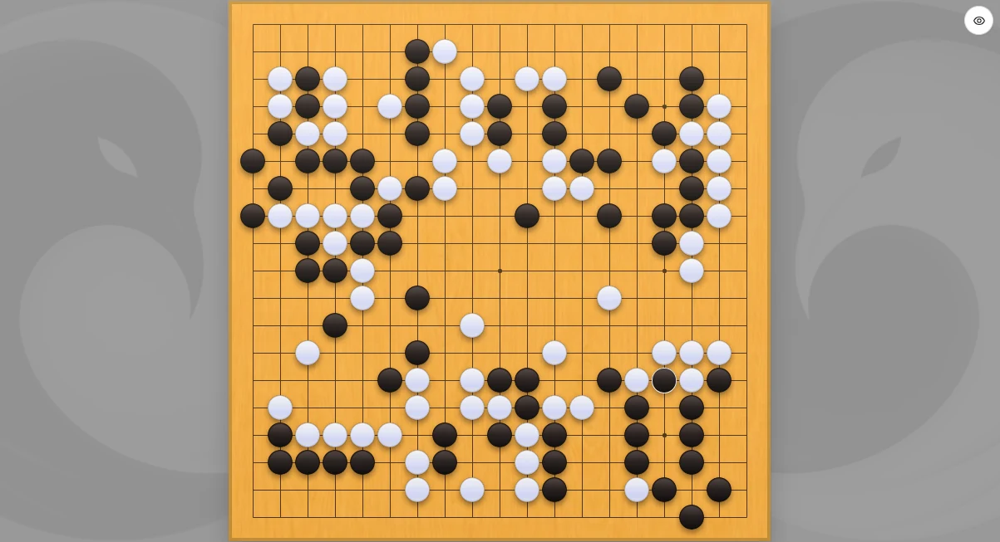
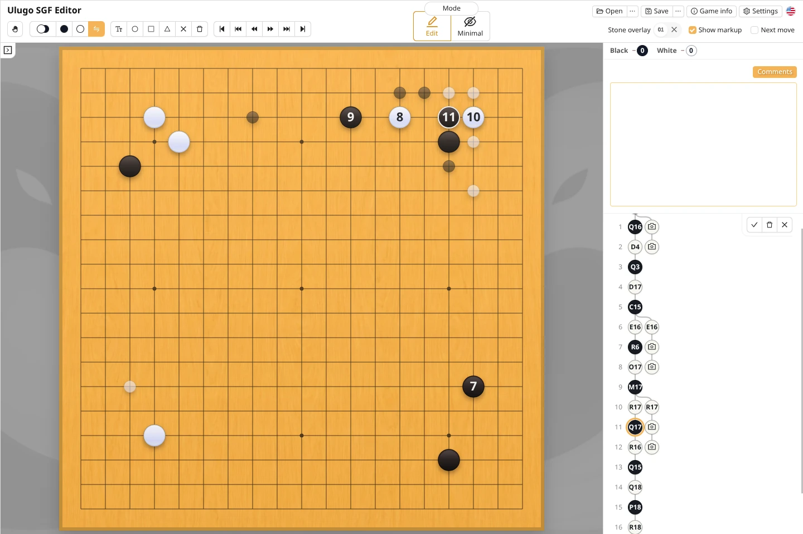

Mit Ulugo kann eine Partie während des Spiels Zug für Zug mitgeschrieben werden. Alternativ lässt sich das Brett regelmäßig mit einem Telefon fotografieren: Der Unterschied zwischen zwei Stellungen wird zunächst als Brettaufstellungsknoten gespeichert und später in der tatsächlichen Reihenfolge in normale Züge umgewandelt.

### Zug für Zug mitschreiben

Beginnen Sie eine neue Partie und setzen Sie die Steine mit dem Werkzeug **Abwechselnd spielen** der Reihe nach auf das Brett.

Auf einem Telefon oder Tablet lässt der Minimalmodus das Brett möglichst viel Bildschirmfläche einnehmen. Über die runde Schaltfläche oben rechts können Zugnummern, Koordinaten, Grundwerkzeuge und der Zugbaum vorübergehend geöffnet werden.

### Züge einfügen oder löschen

- Wählen Sie **⨂ Zug löschen** und klicken Sie auf einen Stein der aktuellen Stellung oder eines späteren Zuges, um ihn zu löschen.
- Wählen Sie **⨁ Zug einfügen** und klicken Sie auf das Brett, um nach der aktuellen Stellung einen Zug hinzuzufügen. Ein Rechtsklick löscht stattdessen einen Zug und wählt die Stellung davor aus.

Beim Öffnen eines der Werkzeuge und beim Wechsel zwischen ihnen bleibt die aktuelle Stellung unverändert. Alle Änderungen werden in einer einzigen temporären Variante zusammengeführt. Während der Bearbeitung beendet nur die Auswahl einer anderen Variante den Vorgang.

Spätere Züge bleiben erhalten, solange sie legal sind. Eingefügte und gelöschte Züge erhalten einen blauen bzw. roten Schatten. Klicken Sie zum Bestätigen auf ✓ oder drücken Sie `Enter`. Klicken Sie auf X oder drücken Sie `Esc`, um abzubrechen und die ursprüngliche Partieaufzeichnung wiederherzustellen.

Beide Werkzeuge lassen sich kombinieren. Um einen falsch notierten Zug zu korrigieren, löschen Sie ihn und fügen anschließend den richtigen Zug ein.

### Mit Fotos mitschreiben

Die Aufzeichnung per Foto eignet sich, wenn Sie den Bildschirm nicht durchgehend bedienen, aber ein reales Brett von Zeit zu Zeit fotografieren können. Dieser Einstieg wird derzeit nur in der mobilen Webversion angezeigt.

Diese Funktion steht nur im Hauptzweig der Partie zur Verfügung.

### Eine Brettaufstellung in normale Züge umwandeln

Nachdem ein Foto zur Partie hinzugefügt wurde, kann der Knoten der fotografierten Stellung zunächst bestehen bleiben. Wenn die tatsächliche Zugfolge bekannt ist, wählen Sie **Zug einfügen** und tragen die Züge der Reihe nach ein.

Während der Ergänzung bleiben weiterhin gültige Inhalte nach dem Knoten der fotografierten Stellung erhalten. Beim Bestätigen wird der Knoten der fotografierten Stellung unmittelbar nach den hinzugefügten Zügen gelöscht; beim Abbrechen wird die Partieaufzeichnung vor der Bearbeitung wiederhergestellt.
