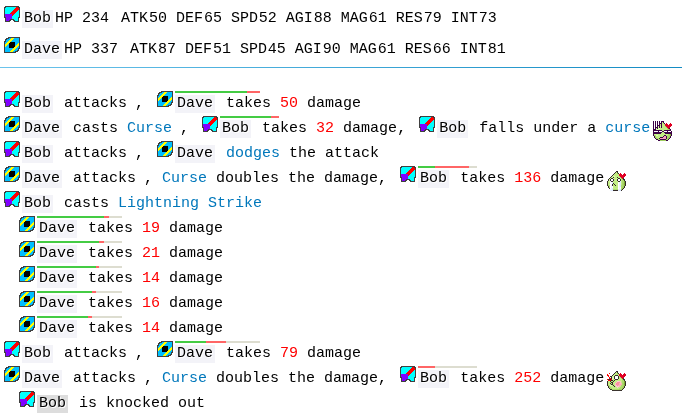

Type in a name and **Namerena** turns it into a fighter with its own stats and skills. Give it a few names and see who’s still standing at the end. Namerena is the sequel to the Flash game [MD5 Battle](/zh/md5.html).

[Play Namerena](/namerena/?lang=en) · [Classic English edition](/namerena/en.html)

## Start a battle

Enter at least two different names, one per line, then click **Fight**. With no blank lines, it’s a free-for-all.

Put a blank line between teams to set up a team battle. In this example, Alice and Bob take on Carol and Dave.

```text
Alice
Bob

Carol
Dave
```

The same names, gear, teams, and [random seed](special.html) give the same result when you replay the battle in the same version.

<figure class="battle-example">
  
</figure>

## Bosses, replays, and languages

- **Challenge a boss.** Enter your fighters, turn on **Challenge**, pick a [boss](special.html), and click **Fight**.
- **Fast-forward and share.** Use fast-forward to skip to the result. Then click **Share** to copy a link others can use to replay the fight.
- **Change languages.** Click the flag in the upper-right corner. Your browser remembers the [language](custom_lan.html) you pick.

## Attributes and skills

Names and clans determine a fighter’s starting stats and skills. Gear, teammates, and status effects can change how that fighter performs.

If your favorite name keeps losing, try a new clan or add a surname. The battle log still shows the name up to the first space.

- [Attributes](attribute.html)
- [Skills](skill.html)
- [Naming rules](naming.html)
- [Testing names](testing.html)

## More guides

- [Languages and custom language packs](custom_lan.html)
- [Embedding the game](api.html)
- [About Namerena](about.html)

<h2 id="community">Community</h2>

Share battle links and compare names with other players in the Chinese-language community.

- [Namerena forum](https://shenjack.top:10008/)
- [Baidu Tieba](https://tieba.baidu.com/%E5%90%8D%E5%AD%97%E7%AB%9E%E6%8A%80%E5%9C%BA)
- QQ group `1079992837`
