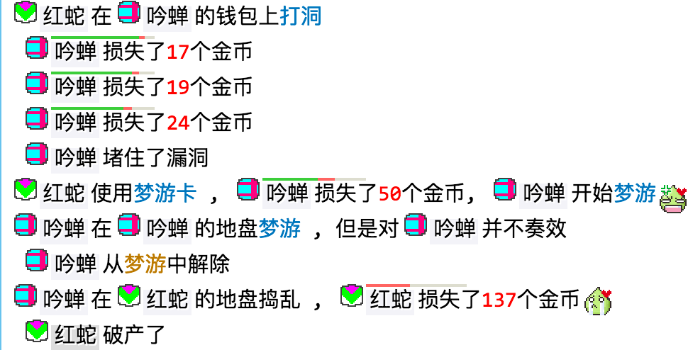
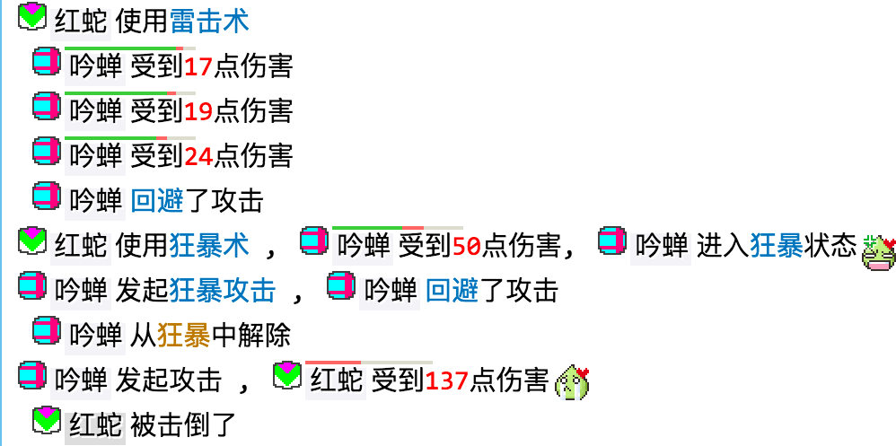

### 切换语言

首次打开新版时，游戏会按浏览器的语言偏好选择一种支持的语言，匹配不到时使用英语。点击右上方的国旗可以切换语言，浏览器会记住你的手动选择。

链接可以通过 `?lang=语言代码` 临时指定语言。打开这样的链接后，仍可通过国旗选择并保存新的偏好。

| 语言 | 示例链接 |
| --- | --- |
| 简体中文 | [`?lang=zh`](/namerena/?lang=zh) |
| English | [`?lang=en`](/namerena/?lang=en) |
| 日本語 | [`?lang=ja`](/namerena/?lang=ja) |
| Deutsch | [`?lang=de`](/namerena/?lang=de) |
| 한국어 | [`?lang=ko`](/namerena/?lang=ko) |
| Français | [`?lang=fr`](/namerena/?lang=fr) |
| Español | [`?lang=es`](/namerena/?lang=es) |
| Português (Brasil) | [`?lang=pt-BR`](/namerena/?lang=pt-BR) |
| العربية | [`?lang=ar`](/namerena/?lang=ar) |
| Русский | [`?lang=ru`](/namerena/?lang=ru) |

### 使用其他语言包

- [繁體中文](/namerena/?l=lang%2Fzh-Hant.json)
- [大富翁语言包](/namerena/?l=lang%2Fzh-money.json)用金币代替生命值。如果不喜欢打打杀杀，推荐试一下这个语言包。

`?l=` 接受语言文件的路径或网址。如果链接同时包含 `lang` 和 `l`，游戏优先使用有效的 `lang`。

### 创建自己的语言包

1. <a href="/namerena/lang/zh.json" download>下载简体中文语言文件</a>，以 UTF-8 编辑并保存为 JSON。
2. 保留 JSON 键和值中的占位符，例如 `[0]`、`[1]`、`[2]` 和 `[]`。可以翻译 `[火球术]` 里的文字，保留方括号会继续高亮技能名。缺少的键显示为空白，含 `<` 或 `>` 的翻译会被忽略。
3. 把 JSON 发布到 HTTPS 地址。跨域托管时，语言文件的响应需要允许 `https://deepmess.com` 读取，例如返回 `Access-Control-Allow-Origin: https://deepmess.com`。
4. 输入 JSON 地址并点「打开游戏」。地址会作为 `l` 参数传给游戏。

<form id="language-pack-link">
  <label for="language-pack-url">语言文件地址</label>
  <input id="language-pack-url" type="url" required placeholder="https://example.com/lang.json" style="width:100%"/>
  <button type="submit">打开游戏</button>
</form>

