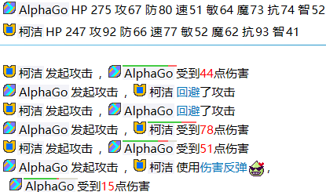

**名字竞技场**是一款文字对战游戏，也是 Flash 游戏 [MD5大作战](/zh/md5.html) 的续作。

[进入名字竞技场](/namerena/?lang=zh) · [Dart 中文旧版](/namerena/zh.html)

### 开始对战

在输入框里每行写一个名字，至少输入两个不同的名字，然后点「开始」。没有空行时，各自为战。要组队，就用空行隔开队伍。

```text
青松
白鹭

山风
海潮
```

这场是青松、白鹭对战山风、海潮。使用同一版本，参战名字、装备、分组和随机种子相同时，战斗结果可以重现。

### 挑战、分享和语言

- **挑战 Boss**。输入你的参战名字，勾选「挑战Boss」，选好 Boss 后点「开始」。
- **快进和分享**。战斗中可以快进。结算后点「分享」，复制链接即可让别人重放这场战斗。
- **切换语言**。点击页面右上方的国旗。浏览器会记住你手动选择的语言，也可以用 `?lang=zh` 临时指定简体中文。详见[语言设置](custom_lan.html)。

<div style="width: 100%;text-align: center;">
	
</div>
### 属性和技能

名字和战队名决定角色的基础属性与技能。装备、同队加成和战斗中的状态都可能改变实际属性。

要在对战中取胜，关键是要找到一个足够强大的名字。

* [属性说明](./attribute.html)
* [技能列表](./skill.html)
* [命名规则](./naming.html)
* [特殊名字](./special.html)
* [测号技巧](./testing.html)

### 其他文档

* [如何把名字竞技场嵌入自己的应用](./api.html)
* [如何使用自定义的语言包](./custom_lan.html)
* [旧版天梯页面](./ladder.html)

### 社区

* [论坛](https://shenjack.top:10008/)
* [百度贴吧](https://tieba.baidu.com/%E5%90%8D%E5%AD%97%E7%AB%9E%E6%8A%80%E5%9C%BA)
* QQ 群 `1079992837`
