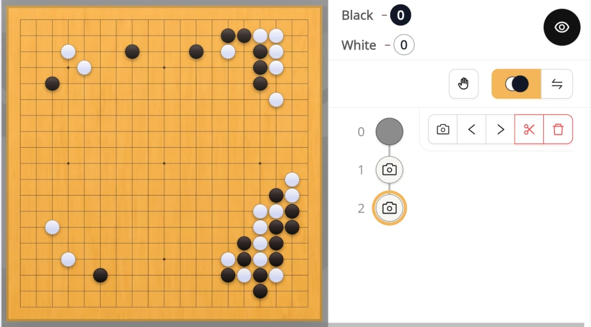
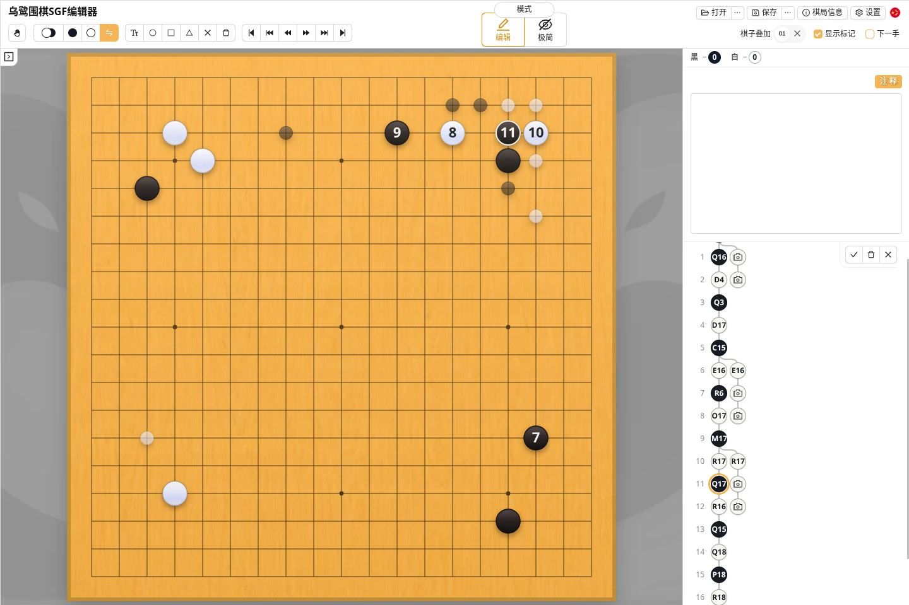

乌鹭围棋既可以在对局过程中逐手记谱，也可以用手机定期拍摄棋盘，将两次盘面之间的差别先记录为盘面设置节点，之后再按实际顺序转换成普通着手。

### 逐手记谱

开始一盘新棋后，使用“黑白交替”工具在棋盘上依次落子。

在手机或平板上，可以使用极简模式让棋盘尽量占满屏幕。右上角的圆形按钮可以临时打开手数、坐标、基础工具和着手树。

### 插入或删除着手

- 选择“⨂ 删除着手”，点击当前盘面或后续着手中的棋子即可删除。
- 选择“⨁ 插入着手”，点击棋盘即可在当前位置之后补录一手；右键点击则删除着手，并跳到被删着手的前一步。

进入工具或在两者之间切换时，当前局面不会改变，所有改动也会合并在同一个临时分支中。编辑期间可以选择其他分支才会退出。

仍然合法的后续着手会继续保留。新增和删除的着手分别用蓝色阴影和红色阴影标注。点击✓或按 `Enter` 确认；点击X或按 `Esc` 取消并恢复原棋谱。

两个工具可以结合使用：修正错记的着手时，先删除错误着手，再插入正确着手即可。

### 拍照记谱

拍照记谱适合无法一直操作屏幕、但可以隔一段时间拍摄一次实体棋盘的场景。目前这个入口只在移动设备的网页版中显示。

该功能只对棋谱的主分支有效。

### 将盘面设置转换为普通着手

照片加入棋谱后，可以暂时保留盘面拍照节点；如果知道这段棋的实际落子顺序，也可以选择“插入着手”，依次补录这段棋的实际落子。

补录过程中，盘面拍照节点之后仍然有效的内容会继续保留。确认本次着手编辑时，紧接在后面的盘面拍照节点会被删除；取消则恢复编辑前的棋谱。
